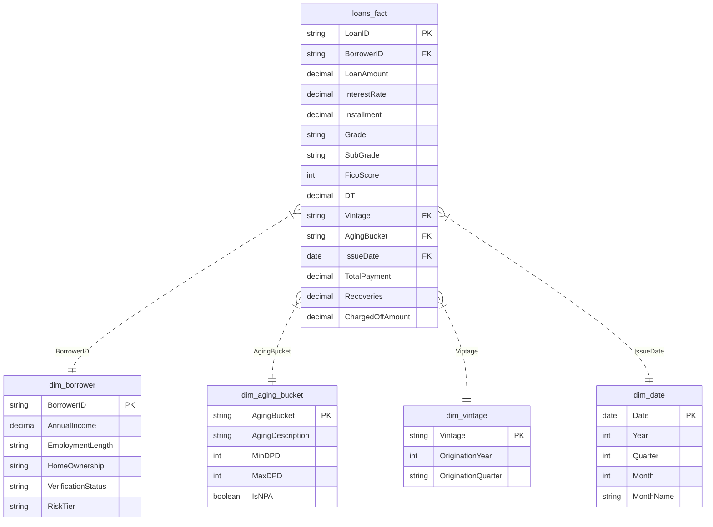

# Power BI Dashboard Specification: Fintech Credit Risk & Loan Portfolio Vintage Analysis

This specification document outlines the semantic data model, dimensional relationships, DAX measure calculations, and visual report designs for enterprise credit risk monitoring across consumer loan portfolios.

---

## 1. Relational Star Schema Architecture

The data model follows an optimized Star Schema design separating transactional loan agreements, borrower demographic attributes, delinquency aging tiers, and vintage cohort dimensions.



---

## 2. Enterprise DAX Measure Dictionary

### 2.1 Core Portfolio & Balance Measures

```dax
// Total Disbursed Loan Volume
Total Funded Capital = 
SUM(loans_fact[LoanAmount])

// Active Portfolio Count
Total Originated Loans = 
DISTINCTCOUNT(loans_fact[LoanID])

// Weighted Average Interest Rate
Weighted Average Coupon = 
DIVIDE(
    SUMX(loans_fact, loans_fact[InterestRate] * loans_fact[LoanAmount]),
    [Total Funded Capital],
    0
)

// Portfolio Average FICO Score
Average Portfolio FICO = 
AVERAGE(loans_fact[FicoScore])

// Average Debt-to-Income Ratio
Average Portfolio DTI = 
AVERAGE(loans_fact[DTI])
```

### 2.2 Delinquency, NPA & Risk Tier Measures

```dax
// Portfolio at Risk (PAR 90+ / Non-Performing Assets)
PAR 90 Exposure = 
CALCULATE(
    [Total Funded Capital],
    dim_aging_bucket[IsNPA] = TRUE()
)

// PAR 90 Ratio (%)
PAR 90 Ratio = 
DIVIDE(
    [PAR 90 Exposure],
    [Total Funded Capital],
    0
)

// Gross Realized Write-Off Losses
Total Write Off Losses = 
SUM(loans_fact[ChargedOffAmount])

// Portfolio Default Rate (%)
Portfolio Default Rate = 
DIVIDE(
    CALCULATE(COUNTROWS(loans_fact), loans_fact[ChargedOffAmount] > 0),
    COUNTROWS(loans_fact),
    0
)

// High-Risk Tier Write-Off Concentration (%)
High Risk Loss Share = 
DIVIDE(
    CALCULATE([Total Write Off Losses], dim_borrower[RiskTier] = "High Risk"),
    [Total Write Off Losses],
    0
)
```

### 2.3 Vintage Performance & Loss Rate Measures

```dax
// Cumulative Net Loss Rate (%) by Vintage Cohort
Cumulative Net Loss Rate = 
DIVIDE(
    [Total Write Off Losses],
    [Total Funded Capital],
    0
)

// 24-Month Seasoned Loss Benchmark
Vintage Loss at MOB 24 = 
CALCULATE(
    AVERAGE(vintage_loss_matrix[24]),
    ALLEXCEPT(dim_vintage, dim_vintage[Vintage])
)
```

---

## 3. Interactive Multi-Page Report Layout

### Page 1: Executive Portfolio Overview & Delinquency Aging
- **Top Metric Cards (KPI Ribbon):**
  - Card 1: `Total Funded Capital` ($1.66B)
  - Card 2: `Total Active Accounts` (105,000)
  - Card 3: `Weighted Average Coupon` (13.2%)
  - Card 4: `PAR 90+ Ratio` (13.1%)
  - Card 5: `High-Risk Loss Concentration` (64.1%)
- **Visual 1 (Donut Chart):** Delinquency Aging Buckets (Current, 1-29 DPD Grace, 30-59 DPD, 60-89 DPD, 90+ DPD NPA).
- **Visual 2 (Clustered Column Chart):** Exposure vs. Write-Off Loss by Credit Rating Grade (A through G).
- **Visual 3 (Matrix Grid):** Quarterly Vintage Summary displaying Origination Volume, Weighted Coupon, PAR 90, and Cumulative Loss Rate.

### Page 2: Credit Underwriting Risk Drivers & Segment Profiling
- **Visual 1 (Scatter / Bubble Plot):** FICO Score (X-axis) vs. Debt-to-Income Ratio (Y-axis) color-coded by Risk Tier (`Low`, `Moderate`, `High`) with bubble size mapped to Loan Amount.
- **Visual 2 (100% Stacked Bar Chart):** Loan Status Composition by Credit Inquiries Bucket (0, 1, 2, 3+ inquiries).
- **Visual 3 (Boxplot / Violin Visual):** Average Order Value / Installment Burden distribution across Home Ownership tiers (`RENT`, `MORTGAGE`, `OWN`).
- **Visual 4 (Decomposition Tree):** Root write-off breakdown branching from Total Write-Offs -> Risk Tier -> Grade -> DTI Decile.

### Page 3: Loan Vintage Curves & Cumulative Loss Heatmap
- **Visual 1 (Multi-Line Chart - Vintage Curves):**
  - X-Axis: Months on Book (`MOB 1 to 36`).
  - Y-Axis: `Cumulative Net Loss Rate (%)`.
  - Legend: Origination Vintages (`2018-Q1` through `2021-Q4`).
  - Annotation: Highlight peak loss acceleration zone (MOB 12 to MOB 24).
- **Visual 2 (Matrix Heatmap):**
  - Rows: Origination Vintages (`2018-Q1` to `2021-Q4`).
  - Columns: Months on Book (`MOB 1` to `MOB 24`).
  - Values: `Cumulative Loss Rate (%)` with conditional color gradient formatting (Yellow to Red).
